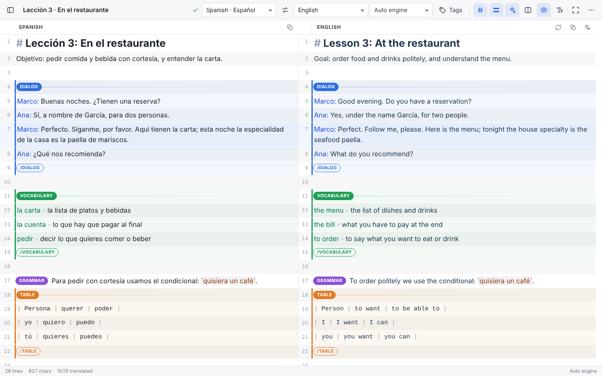
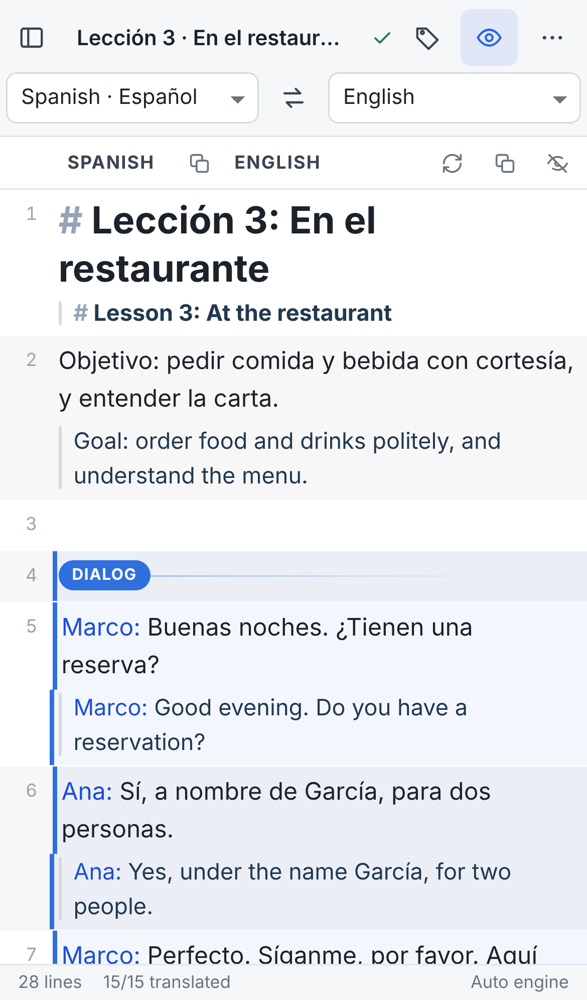
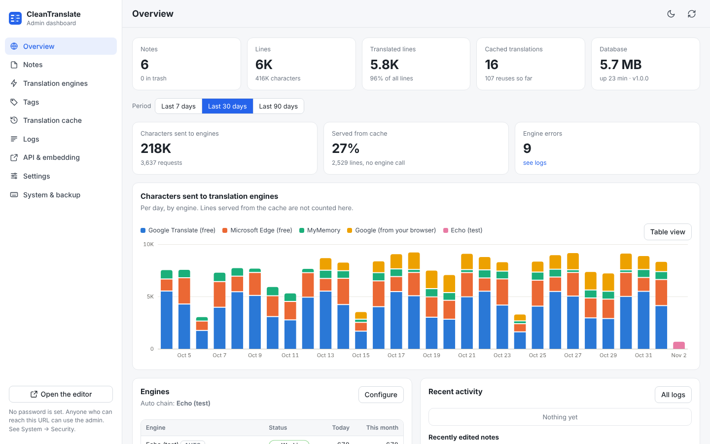

# CleanTranslate

A maximized, line-aligned translation notes editor. Write in the left pane; the
translation appears in the right pane **on the same line number, always** — however
long either side gets. Notes autosave, only the lines you change are re-translated,
and a small self-hosted backend acts as a translation "middleman" in front of Google's
free web translator and several other free or keyed engines, with an admin dashboard
at `/admin`.

Zero npm dependencies: one Node.js process (SQLite is built into Node), or one Docker
container.



| Phone (stacked layout) | Admin dashboard |
|---|---|
|  |  |

## Highlights

- **Lines always line up.** Every line is one row containing the original and the translation, so a row is as tall as its longest side; both panes scroll together. Line numbers on both panes, optional alternating shades, current-line highlight across both panes.
- **Maximized and mobile-friendly.** Full-window layout, fullscreen / focus mode, hideable translation pane, resizable split, side-by-side or *stacked* layout (translation under each line — automatic on phones), dark mode, adjustable text size and font, installable as an app (PWA).
- **Incremental translation.** Each line has a translation key (text + structure + languages). Editing a line translates only that line; reopening a note translates nothing. Results are cached on the server, so repeated lines never cost an engine call.
- **Tags as pills**, Markdown-style: `[DIALOG]`, `[GRAMMAR]`, `[VOCABULARY]`, `[TABLE]`, `[STORY]`, `[EXERCISE]`, `[NOTRANSLATE]` — add your own in the admin. Type `/` on an empty line, press <kbd>Ctrl+K</kbd> or use the Tags button.
- **Smart translation of structure**: dialog speaker names are kept, table cells are translated one by one, Markdown markers (`#`, `-`, `1.`, `>`) and `` `backticks` ``, `{{vars}}`, `____` blanks and URLs are never translated, `NOTRANSLATE` lines are copied.
- **Autosave** with offline backup on the device, conflict detection between tabs/devices, version history with restore, trash.
- **Many engines with automatic fallback**: Google (free web endpoint), Google directly from the visitor's browser, Microsoft Edge (free), Lingva, MyMemory, LibreTranslate, DeepL, Google Cloud, Azure, any custom JSON API, or another CleanTranslate instance. Rate-limited engines cool down and the next one answers.
- **Middleman API** (`/api/v1/translate`) and a **LibreTranslate-compatible** endpoint, with optional API key, CORS and rate limits.
- **Runs anywhere**: own domain/subdomain, a sub-path of an existing site (`BASE_PATH=/translate`), or embedded in another dashboard (`<iframe … ?embed=1>`).

## Quick start

Get the code first (every option below runs from this folder):

```bash
git clone https://github.com/profedominik/cleangoogletranslate.git && cd cleangoogletranslate
```

### Docker

```bash
docker build -t cleantranslate .
```

```bash
docker run -d --name cleantranslate --restart unless-stopped -p 8080:8080 -v cleantranslate-data:/data cleantranslate
```

Open `http://SERVER:8080/` (editor) and `http://SERVER:8080/admin` (dashboard).

### Docker Compose

```bash
cp .env.example .env
```

```bash
docker compose up -d
```

Add a private, unlimited LibreTranslate engine next to it (needs 2–4 GB RAM; enable it afterwards in Admin → Engines):

```bash
docker compose --profile libre up -d
```

### Debian / Ubuntu installer (VPS)

```bash
sudo ./install.sh
```

That installs Node.js 24 if needed (NodeSource), creates a `cleantranslate` system user and a hardened systemd service, stores data in `/var/lib/cleantranslate` and settings in `/etc/cleantranslate.env`. Useful options (combine freely):

| Command | What it does |
|---|---|
| `sudo ./install.sh --domain translate.example.com --admin-auth admin:S3cret` | Installs Caddy with automatic HTTPS for that domain and password-protects `/admin` |
| `sudo ./install.sh --base-path /translate` | Serves the app at `…/translate/` |
| `sudo ./install.sh --docker` | Runs it in Docker instead of systemd (installs Docker if needed) |
| `sudo ./install.sh --port 9000` | Listens on another port |
| `git pull && sudo ./install.sh --update` | Updates in place; notes and settings are kept |
| `sudo ./install.sh --status` | Service status and health check |
| `sudo ./install.sh --uninstall` (`--purge`) | Removes the service (and, with `--purge`, all data) |

### Without Docker or the installer

Requires Node.js **22.13 or newer** (24 LTS recommended). No `npm install` needed:

```bash
node server/index.js
```

Configure with environment variables (see [Configuration](#configuration)), e.g. `PORT=9000 DATA_DIR=/srv/ct node server/index.js`.

## Using the editor

**Lines.** Each row is one line of your note; <kbd>Enter</kbd> splits a line, <kbd>Backspace</kbd> at the start joins it with the line above, multi-line paste creates rows. Click a line number to select lines (<kbd>Shift</kbd>/<kbd>Ctrl</kbd> to extend) and copy, cut, delete, re-translate or wrap them in a tag. **Plain-text mode** (⋯ menu) edits the whole note as one text box; unchanged lines keep their translations.

**Translations.** Lines are translated about half a second after you stop typing (<kbd>Ctrl+Enter</kbd> = now). A spinner marks lines in flight; a red mark means the engine failed (click to retry). You can type into the translation pane to correct it — that line is then marked as edited by hand and is not overwritten; if its original changes later it shows an amber "refresh" mark instead. "Translate everything again" re-requests all machine translations.

**Tags.** A tag alone on a line opens a block that lasts until `[/TAG]`, `[/]` or the next block; `[TAG] text` tags just that line. Tags appear as colored pills, sections get a colored edge in both panes, and both panes mirror the pills.

| Default tag | Kind | Effect |
|---|---|---|
| `DIALOG` | section | `Ana: Hola` keeps the speaker name, translates the speech; speaker highlighted |
| `GRAMMAR` | section | Grammar notes |
| `VOCABULARY` | section | `term - meaning` lines, term highlighted |
| `TABLE` | section | `| a | b |` rows translated cell by cell, monospaced |
| `STORY` | section | Reading passages, serif font |
| `EXERCISE` | section | Exercises, `____` blanks preserved |
| `NOTRANSLATE` | span | Never sent to a translator; copied as is. Works inside other sections |

Add, recolor or remove tags in **Admin → Tags** (kinds: *section*, *span*, *line*; styles; translate on/off), or create one on the fly from the tag menu.

**Never translated:** `` `backticks` ``, `{{variables}}`, runs of `___`, URLs, Markdown prefixes (`#`, `>`, `-`, `1.`), numbers-only lines, and everything inside `NOTRANSLATE`.

**Keyboard:** <kbd>Ctrl+K</kbd> tags · <kbd>Alt+1…9</kbd> insert tag N · <kbd>Alt+↑/↓</kbd> move line · <kbd>Ctrl+Z</kbd>/<kbd>Ctrl+Y</kbd> undo/redo · <kbd>Ctrl+A</kbd> twice select all lines · <kbd>Alt+T</kbd> translation pane · <kbd>Alt+L</kbd> layout · <kbd>Alt+F</kbd> fullscreen · <kbd>Alt+N</kbd> notes · <kbd>Ctrl+S</kbd> save now · <kbd>Ctrl+/</kbd> help.

**Saving.** Every change is saved automatically (indicator next to the title). If the server is unreachable the note is kept on the device and sent when the connection returns. If the same note was changed in another tab or device you choose: load theirs, overwrite with yours, or save yours as a copy. **Version history** (⋯ menu) keeps snapshots, including one before any large deletion.

**Export / print:** side-by-side printable page (save as PDF), text, Markdown, CSV (Excel/Sheets, one row per line) or JSON. **Import:** `.txt`, `.md` or CleanTranslate `.json`.

## Translation engines

With the engine set to **Auto**, engines marked "In auto chain" are tried in order (reorder them in Admin → Engines). An engine that is rate-limited or out of quota is paused (cool-down doubles on repeated blocks; quota errors pause until midnight UTC) and the next one answers. If every server engine fails, the editor can translate **directly from the visitor's browser** (Google), then stores the result in the server cache.

| Engine | Account / key | Free allowance | Notes |
|---|---|---|---|
| **Google Translate (free web)** — default | none | no published limit | Unofficial endpoint (`translate.googleapis.com`, client=gtx); best coverage (130+ languages). Shared VPS/datacenter IPs get captcha-blocked after bursts (HTTP 302 → google.com/sorry); CleanTranslate detects it and falls through. |
| **Google (from your browser)** | none | per visitor IP | Runs in the editor, from the user's own connection — avoids VPS IP blocks. Editor only (not the API). |
| **Microsoft Edge (free)** | none | no published limit | Unofficial: the token used by Edge's built-in translator. Batches many lines per request; good second engine. |
| **Lingva** | none | depends on instance | Open-source Google front-end. Public instances come and go — list several, or self-host (`thedaviddelta/lingva-translate`). |
| **MyMemory** | none (email optional) | ~5,000 chars/day; ~50,000/day with an email | 500 bytes per request (long lines are split). Best with an explicit source language. |
| **LibreTranslate** | none when self-hosted | unlimited self-hosted | Open source, private, offline. `docker compose --profile libre up -d`. The libretranslate.com instance needs a paid key. |
| **DeepL API** | DeepL account (card for verification) | 500,000 chars/month on API Free | Excellent quality, ~30 languages. Free keys end in `:fx`. |
| **Google Cloud Translation** | Google Cloud project + billing + API key | first 500,000 chars/month | Official API, reliable volume. |
| **Azure AI Translator** | Azure account + key + region | 2,000,000 chars/month on tier F0 | Official Microsoft API. |
| **Custom JSON API** | depends | depends | Any HTTP/JSON service via URL, headers, body template and response path. Presets: simple JSON, LibreTranslate-compatible, DLX/DeepLX (self-hosted, unofficial), Lingva-compatible. |
| **Another CleanTranslate** (middleman) | optional API key | — | Forward to another instance's `/api/v1/translate` — e.g. a hub on a different IP or one holding paid keys. |

Free allowances and terms are set by the providers and change over time — check their pages; the admin dashboard shows daily/monthly usage per engine and meters for engines with known limits. The same notes (signup requirements, limits, caveats) are shown next to each engine in **Admin → Engines**, where you can also enter keys, test an engine, reorder the chain and add more engines.

> **Running on a VPS?** The free Google endpoint often captcha-blocks shared datacenter IPs. Keep **Browser fallback** on (Admin → Settings), add Microsoft Edge / Lingva / MyMemory to the chain, self-host LibreTranslate, or add a keyed engine for guaranteed volume.

## Middleman API

The server is also a translation service for other apps, scripts or dashboards. It uses the same cache, engines and fallback chain as the editor.

```bash
curl -X POST https://translate.example.com/api/v1/translate -H "Content-Type: application/json" -d '{"q": ["Hello world", "How are you?"], "source": "auto", "target": "es"}'
```

```json
{
  "translations": [
    { "text": "Hola Mundo", "detectedSourceLanguage": "en", "engine": "google-free", "cached": false },
    { "text": "¿Cómo estás?", "detectedSourceLanguage": "en", "engine": "google-free", "cached": false }
  ],
  "detectedSourceLanguage": "en",
  "source": "auto",
  "target": "es"
}
```

| Endpoint | Purpose |
|---|---|
| `POST /api/v1/translate` | `{ q: string \| string[], source?, target, engine?, markup? }`. A string `q` also returns `translatedText`. `engine`: `auto` or an engine id. `markup: true` protects backticks, `{{vars}}`, blanks and URLs. |
| `GET /api/v1/translate?q=…&target=…` | Same, for quick tests |
| `GET /api/v1/engines` · `GET /api/v1/languages` | Available engines (and the auto chain) · language codes |
| `POST /api/libre/translate`, `GET /api/libre/languages`, `POST /api/libre/detect` | LibreTranslate-compatible — point LibreTranslate clients at `https://host/api/libre` |
| `GET /api/health` | Health check (never behind auth) |

In **Admin → API & embedding** you can disable the public API, require an API key (`Authorization: Bearer <key>`, `X-API-Key` or `api_key`), restrict CORS origins, set a per-IP rate limit, and try requests in a live console.

## Deployment patterns

**Own (sub)domain** — easiest: `sudo ./install.sh --domain translate.example.com`, or put any reverse proxy in front of port 8080: [`deploy/Caddyfile`](deploy/Caddyfile), [`deploy/nginx-subdomain.conf`](deploy/nginx-subdomain.conf).

**A section of an existing site** (e.g. `https://example.com/translate/`): start the app with `BASE_PATH=/translate` and proxy that path — see [`deploy/nginx-subpath.conf`](deploy/nginx-subpath.conf), [`deploy/Caddyfile`](deploy/Caddyfile) or [`deploy/apache.conf`](deploy/apache.conf). The app also accepts requests with the prefix already stripped.

**Inside another dashboard**: embed it with an iframe; `?embed=1` hides the notes list and admin link, `&note=ID` opens a specific note:

```html
<iframe src="https://translate.example.com/?embed=1" style="width:100%;height:80vh;border:0" allow="clipboard-write; fullscreen"></iframe>
```

Allow the parent site in Admin → API & embedding (CSP `frame-ancestors`; default `*`) or with `FRAME_ANCESTORS`.

**Security.** There is no login by default (as requested for now). Before exposing the server publicly, set `ADMIN_AUTH=user:password` (protects `/admin` and the admin API) or `BASIC_AUTH=user:password` (protects everything), serve it over HTTPS, or put it behind your proxy's authentication. `ADMIN_ENABLED=false` removes the dashboard entirely.

**Backups.** Everything lives in one SQLite file (`DATA_DIR/cleantranslate.db`). Download a consistent copy or export all notes as JSON from Admin → System & backup.

## Configuration

All optional, as environment variables (`/etc/cleantranslate.env` for the installer, `.env` for Compose):

| Variable | Default | Meaning |
|---|---|---|
| `PORT` | `8080` | Listening port |
| `HOST` | `0.0.0.0` | Listening address (`127.0.0.1` when a proxy runs on the same host) |
| `BASE_PATH` | *(empty)* | Serve under a sub-path, e.g. `/translate` |
| `DATA_DIR` | `./data` (`/data` in Docker) | Where the SQLite database is stored |
| `ADMIN_AUTH` | *(empty)* | `user:password` to protect `/admin` |
| `BASIC_AUTH` | *(empty)* | `user:password` to protect the whole app |
| `ADMIN_ENABLED` | `true` | `false` removes the admin dashboard |
| `FRAME_ANCESTORS` | *(admin setting)* | Who may embed the app in an iframe (CSP) |
| `TRUST_PROXY` | `true` | Use `X-Forwarded-For` for per-IP rate limits |
| `EDITOR_RATE_LIMIT` | `600` | Max editor translate requests per minute per IP |
| `NODE_USE_ENV_PROXY` + `HTTPS_PROXY` | — | Reach the engines through an outbound HTTP proxy (Node ≥ 22.21) |

Everything else (default languages and engine, autosave/translate delays, snapshot policy, cache size, cool-down, browser fallback, API key/CORS/rate limit, editor defaults, tags, engine keys and order) is set in the admin dashboard and stored in the database.

## Development

```text
server/            Node HTTP server (no dependencies)
  app.js           routing, base path, auth, CSP, static files, maintenance
  db.js            SQLite schema & queries (node:sqlite)
  translator.js    cache, dedupe, markup protection, fallback chain, cool-downs, usage
  engines/         one adapter per engine type
  routes/          notes & editor API, admin API, public middleman API
public/
  index.html       editor            admin/index.html  dashboard
  shared/          code used by both browser and server (markup parser, languages, Google helpers)
  assets/js/       editor.js (aligned rows), translate-queue.js, sync.js (autosave), main.js, admin.js
test/              node:test unit/API/engine tests, e2e/ Playwright browser tests
deploy/            reverse-proxy and systemd examples
```

```bash
npm test
```

Runs 42 unit, API and engine-adapter tests (engines are tested against mocked HTTP; no network needed).

```bash
npm run test:e2e
```

Drives the real UI in Chromium against an offline test engine (alignment, editing, tags, autosave, incremental translation, conflicts, mobile layout, admin). Needs Playwright: `npm i -D playwright && npx playwright install chromium`.

`CT_TEST_MODE=1 node server/index.js` starts the server with only the offline "echo" engine, handy for UI work without touching real translators.

## Notes

- The free Google and Microsoft Edge endpoints are unofficial and may change or stop working without notice; the fallback chain, cache and keyed engines exist so the editor keeps working when they do.
- Respect each provider's terms of use, especially when exposing the middleman API to other users.
